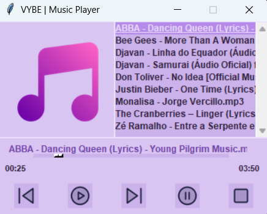

# 🎵 VYBE | Music Player

Um player de música desenvolvido em Python, com interface gráfica construída utilizando Tkinter e uma identidade visual em tons de roxo e lavanda.

O **VYBE Music Player** foi criado com o objetivo de oferecer uma experiência simples e intuitiva para reproduzir músicas diretamente do computador.

## 🖥️ Apresentação do projeto

## ✨ Funcionalidades

- Listagem automática das músicas armazenadas na pasta `músicas`.
- Reprodução de arquivos de áudio.
- Controles para avançar e voltar entre as músicas.
- Opções para pausar, continuar e interromper a reprodução.
- Interface gráfica personalizada.
- Ícones personalizados para os controles do player.
- Organização das músicas em uma lista com barra de rolagem.
- Barra de progresso da reprodução.
- Suporte aos formatos MP3, WAV e OGG.

## 🛠️ Tecnologias utilizadas

O projeto foi desenvolvido utilizando:

- **Python:** linguagem de programação utilizada no desenvolvimento.
- **Tkinter:** criação da interface gráfica.
- **Pygame:** reprodução dos arquivos de áudio.
- **Pillow:** carregamento e manipulação das imagens utilizadas na interface.
- **Mutagen:** obtenção de informações sobre os arquivos de áudio.
